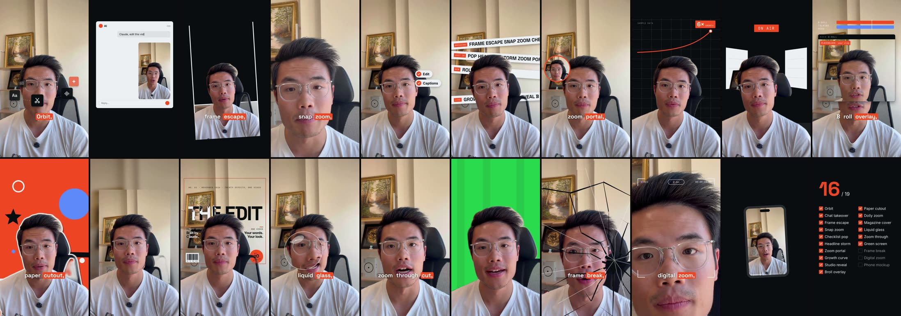

# Video Editor for Claude

Drop in a clip you filmed on your phone. Get back a finished video for Reels, TikTok and Shorts, with the pauses gone, captions on, effects on the right words, sound, and your own look. You don't need to know anything about editing.

Everything runs on your computer. Your footage stays there.



## Quick start

About 10 minutes, most of it a download you don't have to watch.

**You need:** a Mac or Linux computer, about 3 GB free, and [Claude Code](https://claude.com/claude-code) or Claude Cowork. Windows works through Git Bash but has had less testing.

### 1. Install the plugin

**Claude Code.** Paste these one at a time:

```
/plugin marketplace add takiw3/video-editor-plugin
```

```
https://github.com/takiw3/video-editor-plugin
```

**Claude Cowork.** Download `video-editor-plugin.zip` from the [latest release](https://github.com/takiw3/video-editor-plugin/releases/latest), then add it from the plugin menu.

### 2. Set it up

Type `/video-editor:setup` (in Cowork, ask Claude to "set up the video editor"). Claude downloads everything it needs into one `video-editor` folder in your home folder. About 2 GB, no admin password, nothing to install by hand. If it gets cut off, run it again and it picks up where it stopped.

### 3. Set your look

`/video-editor:style`. Pick a preset in 30 seconds, point it at your website, or show it videos you like. Every effect takes your colours and fonts from here.

### 4. Edit your first video

`/video-editor:edit`, then drag in a clip. Claude cuts it and shows you a storyboard of every moment: what's on screen and what you'll hear. Leave a note on anything you want changed. Nothing renders until you say go. The finished video lands next to your original clip, with a smaller copy for your phone.

### 5. Try the starter pack

Twenty effects come ready to use, the ones from the "20 Video Effects Created by Claude" reel. Ask for them by name while you edit:

> Add orbit on the intro, snap zoom on "this changes everything", and frame break on "break".

Orbit, chat takeover, frame escape, snap zoom, checklist pop, headline storm, zoom portal, growth curve, studio reveal, b-roll overlay, paper cutout, dolly zoom, magazine cover, liquid glass, zoom through cut, green screen, frame break, digital zoom, phone mockup and checklist. No setup per effect: each one has working defaults and pulls its words from what you said. Want to see one first? `/video-editor:effects` shows it on your own footage before you commit.

### If something goes wrong

Type `/video-editor:fix` and say what happened. It checks your setup, finds what broke and fixes it. Most problems are a setup that got cut off, and running `/video-editor:setup` again fixes those.

## What's in it

| Command | What it does |
|---|---|
| `/video-editor:edit` | Edit a clip into a finished vertical video |
| `/video-editor:clips` | Pull short clips out of a long video, podcast or webinar |
| `/video-editor:post` | Cover image, feed and YouTube sizes, caption file and post copy |
| `/video-editor:effects` | Browse every effect, or try one on your own footage |
| `/video-editor:style` | Set or change your look |
| `/video-editor:fix` | Something's wrong? It works out what and fixes it |
| `/video-editor:setup` | Get set up, or check things after an update |

**Three edits.** Claude recommends one and you can change it.
- **Studio**: produced, with two framings, full-screen data cards and type behind your head. Best for sit-down videos and numbers.
- **Selfie**: you stay in frame, the real thing lands on top of you or behind you, captions follow your voice word by word. Best for phone clips and tips.
- **Flex**: a different designed effect on every beat. Best when the edit itself is the point.

**244 effects.** Ask for one by name or just describe it ("the old film one", "zoom in hard on that line"). 159 picture effects and 17 voice effects, 59 big designed moments like a receipt printer, a magazine cover or a frame that shatters, and 9 animated data cards. Every one takes your colours.

**It handles the annoying parts.** iPhone HDR footage that normally comes out grey. Phone clips that drift out of sync. Sideways video. Retakes, pauses and "um"s. Brand colours that wouldn't be readable on screen.

**It checks its work.** Every render gets checked for lip sync, loudness and flashes that can hurt people with photosensitive epilepsy, before you see it.

## What it won't do

It won't post for you, write your script, promise views, copy someone else's video shot for shot, or use a song you don't have the rights to. It'll flag anything private on screen and ask about anyone else on camera.

## How long it takes

On an M2 MacBook, a minute of finished video took about 3 minutes to render with no effects, and about 10 with effects and things behind your head. The cutout for things behind your head only does the moments that use it (a few minutes) and runs while the cards are built. Close other heavy apps while it renders.

## Removing it

`/plugin uninstall video-editor@takigpt`, then delete the `video-editor` folder in your home folder and `.cache/hyperframes`, where the render browser lives. The `video-editor` folder holds your style and your projects too, so move anything you want to keep first.

## Credits

Built on [Reel Kit](https://github.com/justynberk/reel-kit) by Justyn Berkovits and the effects library from the [Hermes video editor](https://github.com/takiw3/hermes-video-editor-agent), both MIT. Rendering by [HeyGen HyperFrames](https://github.com/heygen-com/hyperframes). Full notices: [NOTICE.md](NOTICE.md).

MIT License.
